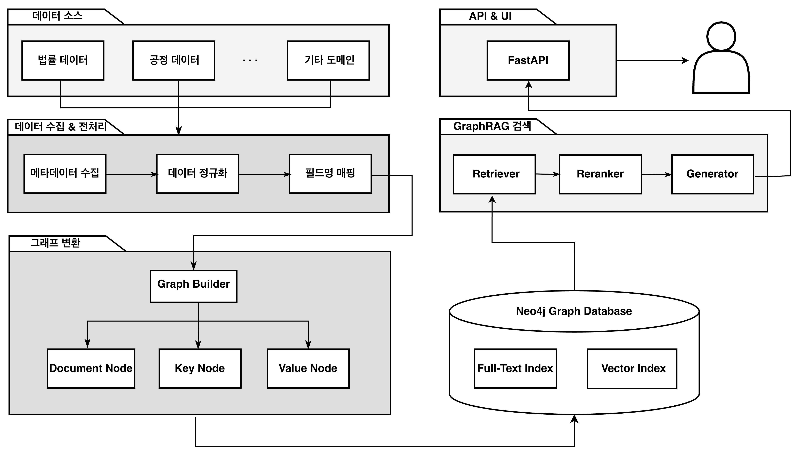
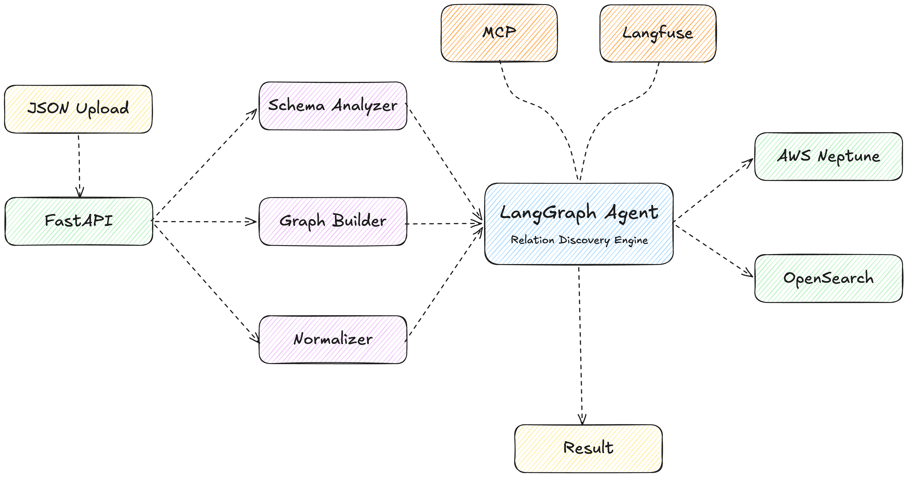

# 액티브 메타데이터 기반 데이터 관계 생성

[](https://www.python.org/downloads/)
[](https://fastapi.tiangolo.com/release-notes/#01110)
[](https://neo4j.com/docs/)
[](https://neo4j.com/docs/neo4j-graphrag-python/current/)

> **[공개 SW] 액티브 메타데이터 기반 데이터 간 관계 자동 생성 기술**
> **Key-Value 기반 그래프 모델**을 활용한 도메인 독립적 데이터 관계 탐색

---

## 개요



다양한 데이터 소스의 액티브 메타데이터를 수집하고, **Key-Value 기반 그래프 구조**로 데이터 간 관계를 자동 생성하는 시스템입니다.

정적 메타데이터 중심의 기존 방식을 넘어, 데이터의 특징과 사용 맥락을 반영하여 **능동적으로 생성·확장·갱신되는 액티브 메타데이터**를 기반으로 데이터 간 의미적 관계와 잠재적 연관성을 탐색할 수 있습니다.

---

## 주요 기능



### 1. 도메인 독립적 그래프 모델
- 특정 도메인 전용 노드 타입 없이 **Key-Value 구조**로 모든 데이터 표현
- 새로운 데이터 유입 시 구조 수정 없이 자동 처리
- 의료, 법률, 공공데이터 등 다양한 도메인 적용 가능

### 2. 데이터 정규화 및 통합
- 정규화 사전 기반 다양한 표현의 통합 (예: "서울대병원", "서울대학병원" → "서울대학병원")
- `SAME_AS` 관계를 통한 원본 값과 정규화 값 연결
- 동일 개체 언급 문서 자동 연결

### 3. GraphRAG 기반 검색
- Key-Value 기반 구조적 필터링
- 정규화 값 기반 유사 문서 탐색
- 그래프 경로를 통한 연결 근거 제시

### 4. 추적 가능성
- 모든 Value는 원본 Document로 추적 가능 (`EXTRACTED_FROM`)
- 정규화 과정도 명시적 관계로 표현 (`SAME_AS`)

---

## 그래프 구조

### 노드 타입

- **Document**: 원본 데이터 레코드
- **Key**: 데이터 필드명 (한글)
- **Value**: 필드의 실제 값
- **NormalizedValue**: 정규화된 대표 값

### 관계 타입

- **HAS_KEY**: Document → Key (문서가 특정 속성을 가짐)
- **HAS_VALUE**: Key → Value (속성이 특정 값을 가짐)
- **EXTRACTED_FROM**: Value → Document (값이 특정 문서에서 추출됨)
- **SAME_AS**: Value → NormalizedValue (값이 정규화됨)

### 예시 구조

```
(Document: 문서1145)
    ├─[HAS_KEY]→ (Key: 병원명)
    │               └─[HAS_VALUE]→ (Value: "서울대병원")
    │                                   ├─[EXTRACTED_FROM]→ (Document: 문서1145)
    │                                   └─[SAME_AS]→ (NormalizedValue: "서울대학병원")
    │
    ├─[HAS_KEY]→ (Key: 병상수)
    │               └─[HAS_VALUE]→ (Value: 83)
    │                                   └─[EXTRACTED_FROM]→ (Document: 문서1145)
    │
    └─[HAS_KEY]→ (Key: 진료과목)
                    ├─[HAS_VALUE]→ (Value: "내과")
                    └─[HAS_VALUE]→ (Value: "한방내과")
```

자세한 내용은 [GRAPH_STRUCTURE.md](./GRAPH_STRUCTURE.md) 참고.

---

## 기대 효과

- 정적 메타데이터 한계를 넘어 **구조 기반 데이터 관계 자동 생성** 가능
- 데이터 탐색, 추천, 연계 자동화에 활용 가능
- 그래프 구조(Knowledge Graph) 기반 확장에 용이
- 도메인 독립적 구조로 다양한 데이터셋 적용 가능

---

## 기술 스택

- **Backend**: FastAPI 0.115.0, Python 3.10-3.12
- **Graph Database**: Neo4j 5.15-community
- **GraphRAG**: neo4j-graphrag 1.10.1
- **LLM Framework**: LangChain, LangGraph
- **Dependency Management**: uv
- **Testing**: pytest

---

## 시작하기

### Quick Start

```bash
# 1. Docker Compose로 Neo4j 실행
$ docker compose up -d

# 2. 의존성 설치
$ uv sync

# 3. 환경 변수 설정 (.env 파일 생성)
$ cp .env.example .env  # 또는 직접 생성

# 4. FastAPI 실행
$ uv run uvicorn app.main:app --host 0.0.0.0 --port 8000 --reload
```

### 요구사항

- [Python](https://www.python.org/) `>=3.10,<=3.12`
- [uv](https://docs.astral.sh/uv/) `>= 0.5.11`
- [Docker](https://www.docker.com/) & [Docker Compose](https://docs.docker.com/compose/)
- [Neo4j](https://neo4j.com/) `5.15-community` (Docker Compose로 자동 실행)

### 1. 의존성 설치

#### uv 설치

**macOS and Linux**
```bash
$ curl -LsSf https://astral.sh/uv/install.sh | sh
```

**Windows**
```powershell
$ powershell -c "irm https://astral.sh/uv/install.ps1 | iex"
```

#### 프로젝트 의존성 설치

```bash
$ uv sync
```

### 2. Neo4j 실행

```bash
# Docker Compose로 Neo4j 실행
$ docker compose up -d

# 상태 확인
$ docker compose ps

# 로그 확인
$ docker compose logs -f neo4j
```

### 3. 환경 변수 설정

`.env` 파일을 생성하고 다음 내용을 설정:

```bash
# Neo4j 설정
NEO4J_URI=bolt://localhost:7687
NEO4J_USER=neo4j
NEO4J_PASSWORD=password

# LLM 설정 (Claude, OpenAI 등)
ANTHROPIC_API_KEY=your_api_key_here
```

### 4. 애플리케이션 실행

**방법 1: 가상환경 자동 진입**

```bash
$ uv run uvicorn app.main:app --host 0.0.0.0 --port 8000 --reload
```

**방법 2: 가상환경 직접 진입**

```bash
$ source .venv/bin/activate
(.venv) $ uvicorn app.main:app --host 0.0.0.0 --port 8000 --reload
```

### 5. 접근

- **FastAPI**: http://localhost:8000
- **API Docs**: http://localhost:8000/docs
- **Neo4j Browser**: http://localhost:7474 (ID: neo4j, PW: password)
- **Neo4j Bolt**: bolt://localhost:7687

---

## 사용 예시

### 데이터 업로드

```bash
# JSONL 파일 업로드 (병원 데이터)
$ curl -X POST "http://localhost:8000/api/graph/upload" \
  -F "file=@병원데이터_test.jsonl"
```

### 그래프 검색

```bash
# 특정 조건 검색: "병상수 > 100인 요양병원"
$ curl -X GET "http://localhost:8000/api/graph/search?query=병상수+100+요양병원"
```

### 그래프 시각화

브라우저에서 http://localhost:8000/static/graph-viewer.html 접속

---

## 프로젝트 구조

```
data-relation-generate/
├── app/
│   ├── api/                        # API 라우터
│   │   └── routers/
│   │       └── graph.py            # 그래프 관련 API
│   ├── clients/                    # 외부 클라이언트
│   ├── repositories/               # 데이터 접근 레이어
│   │   ├── graph_queries.py        # Neo4j 쿼리
│   │   └── graph_repository.py     # 그래프 저장소
│   ├── schemas/                    # Pydantic 스키마
│   │   ├── keyvalue_graph.py       # Key-Value 그래프 스키마
│   │   └── graphrag_api.py         # GraphRAG API 스키마
│   ├── src/                        # 비즈니스 로직
│   │   ├── graphrag/               # GraphRAG 서비스
│   │   └── keyvalue_graph/         # Key-Value 그래프 빌더
│   └── main.py                     # FastAPI 애플리케이션
├── scripts/                        # 유틸리티 스크립트
├── static/                         # 정적 파일 (그래프 뷰어)
├── tests/                          # 테스트
├── .env                            # 환경 변수
└── pyproject.toml                  # 프로젝트 설정 및 의존성
```

---

## Docker Compose 구성

### 서비스 구성

| 서비스 | 포트 | 설명 | 버전 |
|--------|------|------|------|
| neo4j | 7474 (HTTP), 7687 (Bolt) | Neo4j 그래프 데이터베이스 | 5.26-community |

### 볼륨 관리

Docker Compose는 다음 볼륨을 자동으로 생성하여 데이터를 영구 저장합니다:

- `neo4j_data`: Neo4j 데이터베이스 파일 (K8s: 20Gi PVC)
- `neo4j_logs`: Neo4j 로그 파일 (K8s: 5Gi PVC)
- `neo4j_import`: 데이터 임포트용 디렉토리
- `neo4j_plugins`: Neo4j 플러그인

### 개발 vs 배포 환경

| 항목 | 로컬 (Docker Compose) | K8s (배포) |
|------|----------------------|-----------|
| Neo4j 버전 | 5.26-community | 5.26 |
| 인증 | `neo4j/password` (하드코딩) | Secret으로 관리 |
| 메모리 | 동일 설정 | 동일 설정 |
| 플러그인 | APOC, GDS | APOC, GDS |
| 스토리지 | Named Volumes | PersistentVolumeClaim |

---

## 개발 가이드

### 테스트 실행

```bash
$ uv run pytest -v
```

### Neo4j 관리

```bash
# 서비스 중지
$ docker compose stop

# 서비스 시작
$ docker compose start

# 로그 확인
$ docker compose logs -f neo4j

# 완전 삭제 (데이터 포함)
$ docker compose down -v

# 재시작
$ docker compose restart neo4j
```

---

## 참고 자료

### Neo4j GraphRAG
- [Neo4j GraphRAG Python Docs](https://neo4j.com/docs/neo4j-graphrag-python/current/)
- [User Guide: RAG](https://neo4j.com/docs/neo4j-graphrag-python/current/user_guide_rag.html)
- [User Guide: KG Builder](https://neo4j.com/docs/neo4j-graphrag-python/current/user_guide_kg_builder.html)
- [User Guide: Pipeline](https://neo4j.com/docs/neo4j-graphrag-python/current/user_guide_pipeline.html)
- [API Reference](https://neo4j.com/docs/neo4j-graphrag-python/current/api.html)

### LangGraph
- [LangGraph Documentation](https://langchain-ai.github.io/langgraph/)
- [LangChain Documentation](https://python.langchain.com/docs/get_started/introduction)